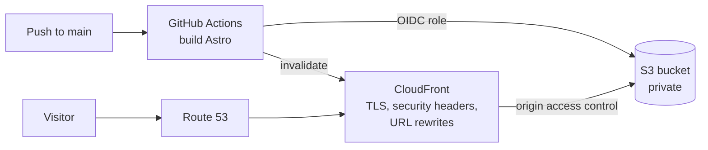

# nicolasmoreale.com

Personal website of Nicolás Moreale, AWS engineer for Amazon Connect contact centers.

The site is static (Astro) and runs on AWS: a private S3 bucket behind CloudFront, with the certificate and DNS in Route 53. Every push to `main` builds the site in GitHub Actions and deploys it through an IAM role assumed with OIDC, so there are no AWS keys stored anywhere.



```
site/    Astro website (pages, case studies, articles)
infra/   AWS CDK stack (S3, CloudFront, ACM, Route 53, deploy role, budget alert)
.github/ Deploy on push to main; build and synth checks on pull requests
```

## Work on the site locally

Needs Node 22.

```bash
cd site
npm install
npm run dev        # http://localhost:4321
```

- Personal details, links and the list of services: `site/src/site.config.ts`
- Case studies: `site/src/content/work/*.md`
- Articles: `site/src/content/writing/*.md` (add a file to publish a new one; `draft: true` hides it)

Before publishing, re-read every case study: no client, program or employer names, and every claim true.

## First deployment

Do this in a **personal** AWS account, never an employer's.

**Regions:** the stack lives in **us-east-2** (Ohio), this account's home region. The organization's region policy blocks CloudFormation and S3 buckets in us-east-1 but allows ACM there, so the stack requests the CloudFront certificate in us-east-1 through a small custom resource. The easiest place to run the commands below is **AWS CloudShell in us-east-2**: it's already signed in and has the AWS CLI and Node.

### 1. Register the domain

In the AWS console, open Route 53, choose **Registered domains**, then **Register domains**, and buy `nicolasmoreale.com`. Route 53 creates a hosted zone for it automatically. Open **Hosted zones**, select the domain and copy its **Hosted zone ID**.

### 2. Fill in the settings

In `infra/cdk.json`, under `context`:

| Setting | Value |
| --- | --- |
| `hostedZoneId` | The ID from step 1 |
| `githubRepo` | Your repository as `owner/repo` |
| `createGithubOidcProvider` | `true`, unless the account already has a GitHub OIDC provider |
| `monthlyBudgetUsd` | Email alert threshold for the whole account |

### 3. Deploy the infrastructure

Run this in AWS CloudShell (us-east-2), or anywhere the AWS CLI is signed in to the account.

```bash
cd infra
npm install
npx cdk bootstrap aws://YOUR_ACCOUNT_ID/us-east-2   # once per account
npx cdk deploy -c alertEmail=you@example.com
```

The alert email is passed on the command line so it stays out of the public repo. The first deploy takes 10 to 20 minutes, most of it waiting for the certificate and CloudFront. When it finishes it prints `SiteBucketName`, `DistributionId` and `DeployRoleArn`.

### 4. Connect GitHub

Create an empty repository on GitHub, then push this folder to it:

```bash
git init -b main
git add .
git commit -m "First version of the site"
git remote add origin https://github.com/OWNER/REPO.git
git push -u origin main
```

Then in the repository open **Settings > Secrets and variables > Actions > Variables** and add:

| Variable | Value |
| --- | --- |
| `AWS_DEPLOY_ROLE_ARN` | `DeployRoleArn` output |
| `SITE_BUCKET` | `SiteBucketName` output |
| `DISTRIBUTION_ID` | `DistributionId` output |

Run the **Deploy site** workflow from the Actions tab (or push any change under `site/`). The site is live at https://nicolasmoreale.com a minute later.

### 5. Email and booking link

- **Email:** the site shows `hello@nicolasmoreale.com`. Set it up with a mail or forwarding provider (for example Zoho Mail, Google Workspace or a forwarding service) and add the MX and TXT records they give you to the Route 53 hosted zone.
- **Booking:** create a free 30-minute event on Cal.com (or Calendly) and paste its link into `bookingUrl` in `site/src/site.config.ts`.

## Costs

Expect roughly a dollar a month at personal-site traffic: $0.50 for the Route 53 hosted zone, plus pennies for S3 and CloudFront. The domain renews yearly at the price shown when you register it. The budget alert emails you at 80% of `monthlyBudgetUsd` and when AWS forecasts you will exceed it.

## Updating the infrastructure

```bash
cd infra
npx cdk diff -c alertEmail=you@example.com
npx cdk deploy -c alertEmail=you@example.com
```

The S3 bucket is retained if the stack is deleted, so the site's files are never removed by accident.
